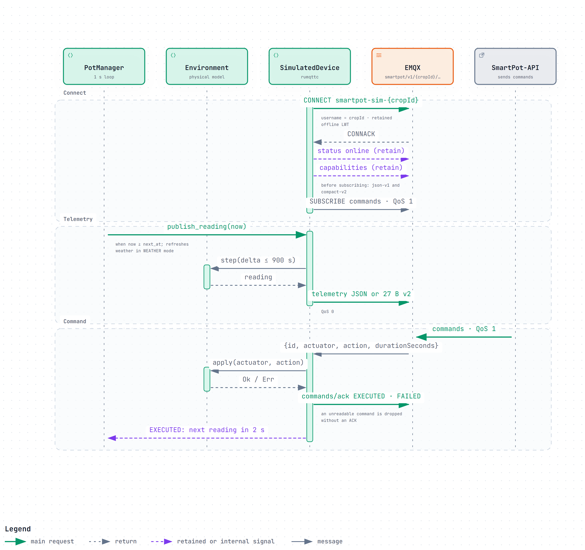
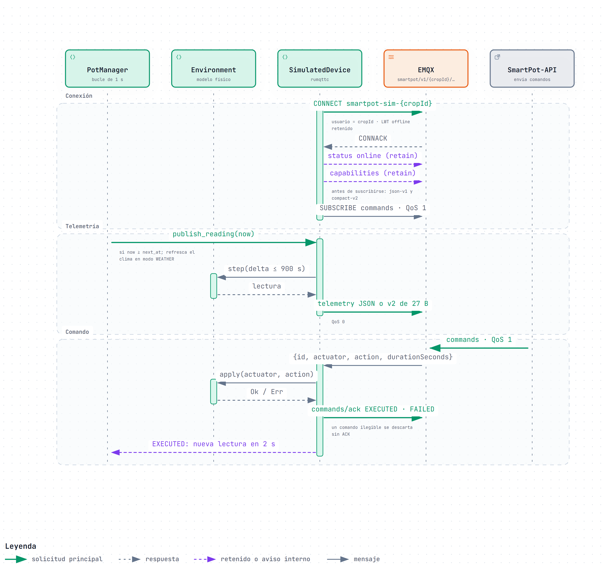

# SmartPot-DataGenerator · Interactive Diagrams

[English](#english) | [Español](#español)

---

## English

Each diagram is a self-contained HTML page that works offline. Download it and open it in a browser to zoom, search nodes, trace a path and jump to the exact source lines on GitHub. The PNG preview is the light-theme render of the same diagram.

### 1. MQTT Session of a Virtual Crop

How one simulated device talks to the broker with exactly the hardware contract. It connects as `smartpot-sim-{cropId}` with the crop credentials and a retained `offline` Last Will, publishes a retained `online` status and its `capabilities` before subscribing to `commands`, and then publishes a reading every time the 1-second `PotManager` loop finds the crop due (JSON v1 or the 27-byte compact v2 packet). A command from SmartPot-API is applied to the physical `Environment`, acknowledged as `EXECUTED` or `FAILED`, and a successful one brings the next reading forward to 2 seconds.

- Interactive: [English](SmartPot_DataGenerator_A1_Virtual_Crop_Session.en.html) · [Spanish](SmartPot_DataGenerator_A1_Virtual_Crop_Session.es.html)
- Sources: `src/device.rs` and `src/pots.rs` at commit `00ca993`.

---

## Español

Cada diagrama es una página HTML autocontenida que funciona sin conexión. Descárgala y ábrela en un navegador para ampliar, buscar nodos, seguir un recorrido y saltar a las líneas exactas del código en GitHub. La vista previa PNG es el mismo diagrama en tema claro.

### 1. Sesión MQTT de un cultivo virtual

Cómo habla un dispositivo simulado con el broker usando exactamente el contrato del hardware. Se conecta como `smartpot-sim-{cropId}` con las credenciales del cultivo y una última voluntad `offline` retenida, publica el estado `online` y sus `capabilities` retenidos antes de suscribirse a `commands` y después publica una lectura cada vez que el bucle de 1 segundo de `PotManager` encuentra que le toca (JSON v1 o el paquete compacto v2 de 27 bytes). Un comando de SmartPot-API se aplica al `Environment` físico, se confirma como `EXECUTED` o `FAILED` y, si se ejecutó, adelanta la siguiente lectura a 2 segundos.

- Interactivo: [inglés](SmartPot_DataGenerator_A1_Virtual_Crop_Session.en.html) · [español](SmartPot_DataGenerator_A1_Virtual_Crop_Session.es.html)
- Fuentes: `src/device.rs` y `src/pots.rs` en el commit `00ca993`.

